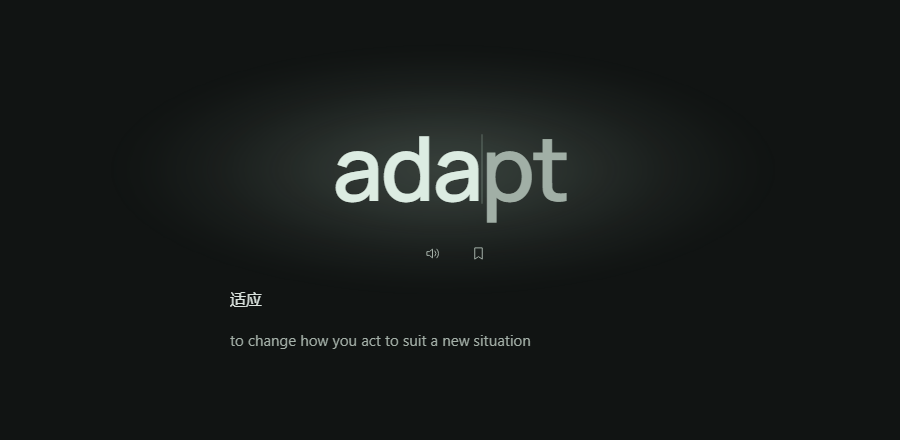
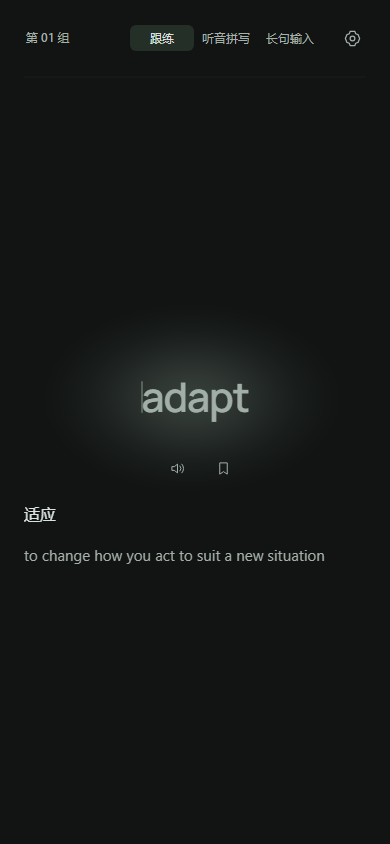
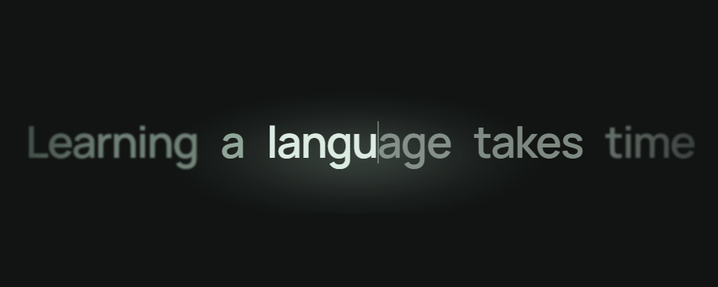

<div align="center">



<br>

[](https://chang814.github.io/project/)
[](https://github.com/chang814/project/releases/download/windows-2026-11-09/Changji-v1.1.3-Windows-x64.exe)
[](https://github.com/chang814/project/releases/download/windows-2026-11-09/Gobang-Windows-x64.zip)


**[⚫ 五子棋](#-五子棋对战游戏--gobang)** · **[📝 畅记](#-畅记--changji)** · **[🧭 仓库维护](#-仓库维护)**

</div>

<br>

这里收录两个可以直接运行的项目：一个是《程序设计训练》课程里和队友一起完成的**五子棋对战游戏**，一个是我自己每天背单词用的**英语练习工具畅记**。两个项目都提供 Windows 免安装版，畅记还可以直接在浏览器里打开。

<table>
<tr>
<th width="50%">⚫ 五子棋对战游戏</th>
<th width="50%">📝 畅记 Changji</th>
</tr>
<tr>
<td valign="top">

课程团队作业 · Windows 桌面游戏

- 本地双人、人机、局域网对战
- **六档 AI**，从随机落子到 12 层深算
- 悔棋、存档、读档、复盘、棋谱导出

<sub>C · C++ · EGE · Winsock2</sub>

</td>
<td valign="top">

个人项目 · 网页 + Windows 桌面

- 跟练、听音拼写、长句输入三种模式
- 四级、六级、基础词库，可导入自己的词表
- **智能复习**：按 FSRS 记忆模型安排，跟练只算看过、默写才算记住
- 学习记录只存在本机，可导出导入

<sub>HTML · CSS · JavaScript · Node.js · Electron</sub>

</td>
</tr>
<tr>
<td align="center"><a href="https://github.com/chang814/project/releases/download/windows-2026-11-09/Gobang-Windows-x64.zip"><b>⬇ 下载 Windows 版</b></a> · <a href="gobang/README.md">源码说明</a></td>
<td align="center"><a href="https://chang814.github.io/project/"><b>▶ 在线使用</b></a> · <a href="https://github.com/chang814/project/releases/download/windows-2026-11-09/Changji-v1.1.3-Windows-x64.exe">⬇ Windows 版</a> · <a href="changji/README.md">源码说明</a></td>
</tr>
</table>

---

## ⚫ 五子棋对战游戏 · Gobang

《程序设计训练》课程的团队实践作业：把五子棋规则、电脑对手和局域网对战整合进一个 Windows 游戏。

<table>
<tr>
<td align="center" width="25%"><h3>👥</h3><b>本地双人</b><br><sub>同一台电脑轮流落子</sub></td>
<td align="center" width="25%"><h3>🤖</h3><b>人机对战</b><br><sub>六档难度，自选风格</sub></td>
<td align="center" width="25%"><h3>🌐</h3><b>局域网对战</b><br><sub>Winsock2 联机</sub></td>
<td align="center" width="25%"><h3>💾</h3><b>存档复盘</b><br><sub>悔棋、读档、导出棋谱</sub></td>
</tr>
</table>

### 🧠 六档 AI，一档一个算法

| 档位 | 核心做法 |
| --- | --- |
| 🌱 入门 | 随机落子 |
| 🙂 简单 | 贪心：只看这一步哪里分最高 |
| 🎯 普通 | 极小极大搜索，4 层 |
| 🔥 困难 | Alpha-Beta 剪枝 + 置换表，6 层 |
| 🧙 大师 | 先查连续冲四（VCF）必胜，再迭代加深到 8 层，配历史与杀手启发 |
| 👑 棋圣 | VCF + 迭代加深到 12 层，专属更长思考时间 |

> [!NOTE]
> 棋圣档原本还接了「活三连攻（VCT）」检测，但自对弈回归发现它常出现“伪必胜”，反而打不过大师。所以把它从自动路径里摘掉，换成更深的搜索，让难度梯度重新拉开。这段取舍写在 [`src/ai.c`](gobang/src/ai.c) 的注释里。

<details>
<summary><b>🛠 编译运行</b></summary>
<br>

在 Windows 上准备 TDM-GCC 4.9.2 x64（Dev-C++ 5.11 随附的 MinGW64）和 EGE 20.08，然后在 `gobang/` 目录的 PowerShell 中：

```powershell
$env:MINGW_HOME = 'C:\path\to\MinGW64'
$env:EGE_HOME = 'C:\path\to\EGE20.08'
.\build.bat
.\gobang.exe
```

`tests/` 里有棋盘与存档测试、AI 测试、输入测试和自对弈工具。完整说明见 [gobang/README.md](gobang/README.md)。

</details>

**我的贡献：** 这是团队协作成果。我主要负责棋局逻辑、存档和 AI 引擎，并参与了联网模块；界面和交互由队友负责。

---

## 📝 畅记 · Changji

我为英语词汇和句子练习做的工具。界面安静、只留下当前要练的那个词。

<table>
<tr>
<td width="62%"></td>
<td width="38%" rowspan="3" align="center"><br><sub>📱 手机浏览器同样可用</sub></td>
</tr>
<tr><td></td></tr>
<tr><td></td></tr>
</table>

<p align="center"><sub>从上到下：⌨️ 跟练 · 🎧 听音拼写 · 📜 长句输入（截图来自线上网页版）</sub></p>

| 模式 | 怎么练 |
| --- | --- |
| ⌨️ **跟练** | 看着单词逐字母打出来，同时显示中英文释义 |
| 🎧 **听音拼写** | 只听读音、只看空位，凭记忆拼出整个词 |
| 📜 **长句输入** | 把整段英文连续打完，练语感和手速 |

<details>
<summary><b>🛠 本地运行、导入词库与打包</b></summary>
<br>

需要 Node.js 22 或更高版本。网页不用安装依赖：

```sh
cd changji
npm start          # 打开 http://127.0.0.1:4176/
```

导入自己的词库（UTF-8，每行一个单词，可用 Tab 再附中文、英文释义，参照 [vocabulary-example.tsv](changji/vocabulary-example.tsv)）：

```sh
npm run import:vocab -- cet6 "D:\词库\我的词库.tsv"
```

打包 Windows 桌面版：

```sh
npm ci
npm run build:win
```

导入的词库保存在被 Git 忽略的 `.local-vocabulary/`，不会进仓库。完整说明见 [changji/README.md](changji/README.md)。

</details>

**许可：** 应用代码与原创示例词条采用 [MIT 许可](changji/LICENSE)；第三方字体等授权见 [THIRD-PARTY-NOTICES.md](changji/THIRD-PARTY-NOTICES.md)。

---

## 📂 目录

| 路径 | 内容 |
| --- | --- |
| ⚫ [`gobang/`](gobang/) | 五子棋：`src/` 棋盘、存档、AI、联网、界面；`tests/` 测试与自对弈 |
| 📝 [`changji/`](changji/) | 畅记：`dist/` 网页源码（也是 Pages 发布目录）、`desktop/` Electron 入口 |
| 📚 [`docs/`](docs/) | 仓库管理准则与 README 用图 |

## 🧭 仓库维护

目录、命名、发布与多人协作约定见 [仓库管理准则](docs/repository-governance.md)。发现问题或有建议，欢迎提 [Issue](https://github.com/chang814/project/issues)。

<br>

<div align="center">

<sub>Made by <a href="https://github.com/chang814">@chang814</a> · 另一个项目：<a href="https://github.com/chang814/codefarm">🌱 Codefarm，用 C++ 种田的编程游戏</a></sub>

</div>
